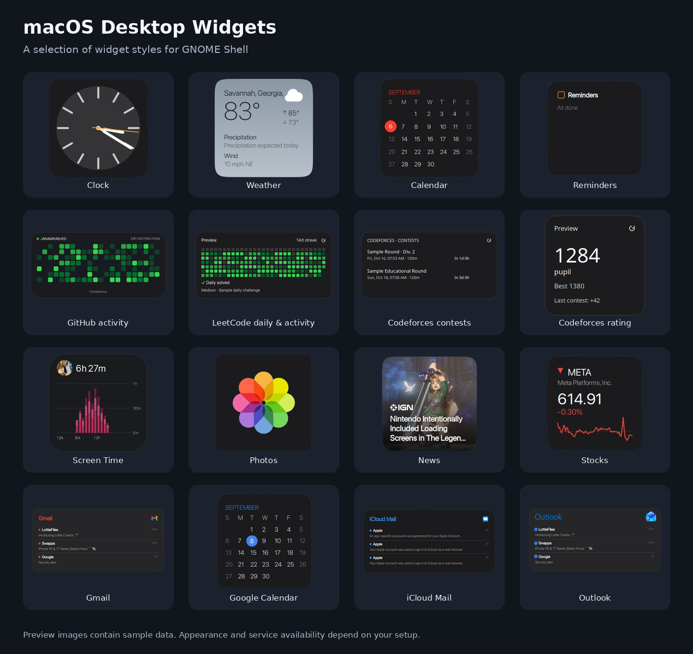

# macOS Desktop Widgets

macOS-style desktop widgets for GNOME Shell, with widget previews, configurable appearance, and account integrations.



- Clock, Weather, Calendar, Reminders, Screen Time, GitHub activity, Photos, and News.
- LeetCode activity heatmap, daily challenge completion, and connected daily streak.
- Separate Codeforces upcoming contests and personal rating widgets.
- Celsius/Fahrenheit weather controls and calendar colors that follow the system appearance.
- Google mail and calendar through GNOME Online Accounts and the bundled account helper.

## Choose your GNOME version

Check your desktop version:

```sh
gnome-shell --version
```

Download the matching **release asset** from this repository's **Releases** page:

| GNOME Shell | Download filename | Testing status |
| --- | --- | --- |
| 45 | `macos-widgets-gnome-45.zip` | Version-adapted; desktop testing needed |
| 46 | `macos-widgets-gnome-46.zip` | Based on the working GNOME 46 desktop version |
| 47 | `macos-widgets-gnome-47.zip` | Version-adapted; desktop testing needed |
| 48 | `macos-widgets-gnome-48.zip` | Version-adapted; desktop testing needed |
| 49 | `macos-widgets-gnome-49.zip` | Version-adapted; desktop testing needed |
| 50 | `macos-widgets-gnome-50.zip` | Version-adapted; desktop testing needed |
| 51 | `macos-widgets-gnome-51.zip` | Version-adapted; desktop testing needed |

All editions have syntax, schema, packaging, and targeted regression checks. The newly packaged editions have not been integration-tested on each target desktop. See [compatibility and validation details](new/README.md).

Each package supports one GNOME major version. All packages share the extension ID `peachos-widgets@peachos`, so install only the edition matching your desktop. It replaces an existing installation with that ID.

## Requirements

- GNOME Shell matching the selected package, GJS, Soup 3, GdkPixbuf, Pango, and Rsvg.
- GLib tools (`glib-compile-schemas`) and Fontconfig (`fc-cache`).
- Account integrations: `/usr/bin/python3` and PyGObject; LeetCode connection also needs GTK 3, libsecret, and an unlocked GNOME Keyring.
- Google integration: GNOME Online Accounts with the relevant mail/calendar permissions.

Package names vary by distribution. The installer does not download dependencies. iCloud Mail, Outlook, and remote Photos retain their external-helper requirements; the bundled Google helper does not provide those services.

## Install

Download the matching ZIP asset, rather than GitHub's automatically generated **Source code** archive. Extract it into an empty folder. For example, for GNOME 46, from the directory containing the download:

```sh
mkdir macos-widgets-gnome-46
unzip macos-widgets-gnome-46.zip -d macos-widgets-gnome-46
cd macos-widgets-gnome-46
bash install.sh
```

Replace `46` with your GNOME major version. The installer checks that version before copying files. It installs the extension and bundled fonts for your user and attempts to enable the extension. Run it without `sudo`.

Log out and back in to load the extension. On an X11 session that supports Shell restart, you can instead press **Alt+F2**, type `r`, and press **Enter**. If necessary, enable **macOS Desktop Widgets** in the Extensions app.

For a source checkout, use `bash install.sh` inside the matching `new/gnome-XX/` folder. The repository root is the development version; use a version-specific package for installation.

## Add and customize widgets

1. Open **Quick Settings** in the top-right corner and select **Widgets** / **Manage Widgets**.
2. Choose a widget preview and drag it onto the desktop.
3. Use edit mode to move or remove widgets; press **Esc** to finish.

Choose **°C** or **°F** under Weather in the picker. Calendar's **System** appearance follows system colors and light/dark appearance. Screen Time measures local usage while the extension runs; it starts collecting history after use.

## Set up accounts

### LeetCode and Codeforces

New installations start with empty usernames. From the extracted package folder, set either or both accounts:

```sh
python3 helpers/configure-accounts.py --leetcode YOUR_LEETCODE_USERNAME --codeforces YOUR_CODEFORCES_HANDLE
```

Reload the extension or log out and back in after changing names. Existing saved usernames are preserved when upgrading. To clear a name, pass an empty string, for example `--leetcode ''`.

LeetCode's green heatmap shows activity. To enable personal daily challenge completion and the official streak, click the username area on its widget and connect your session. The dialog explains how to copy `LEETCODE_SESSION` and `csrftoken` from your signed-in browser. Enter those values only in the local connection dialog; they are validated against your configured username and stored in GNOME Keyring. Reconnect if the session expires. An unavailable or expired session shows an unknown status rather than marking the daily challenge unsolved.

Codeforces upcoming contests work without an account. The separate rating widget needs your public handle; no Codeforces password is required. Picker previews use sample data.

### Google mail and calendar

Add your Google account in **Settings → Online Accounts** and allow the relevant mail and calendar access. The extension includes its Python bridge, so no separate `pearos-google` installation is needed. If access fails, check the account's permissions and reconnect it in Online Accounts.

## Troubleshooting

- **Extension fails to load:** check `gnome-shell --version` and use the matching ZIP. Reload the session after replacing extension files.
- **Weather unavailable:** select a location in the Weather picker and check the network connection.
- **LeetCode connection fails:** confirm the configured username matches the signed-in account, GNOME Keyring is unlocked, and the Python/GTK dependencies are available.
- **Google shows Open Settings or no data:** check Online Accounts and its mail/calendar permissions.
- **No Screen Time history:** leave the extension running during normal use. It does not import older usage history.

For bug reports, include the GNOME version, distribution, Wayland/X11 session, widget name, and steps to reproduce. Remove cookies, tokens, and private account content from logs or screenshots.

## Uninstall

From the extracted package folder:

```sh
bash uninstall.sh
```

Log out and back in afterward. The uninstaller removes the extension; saved settings, keyring entries, and fonts are not removed by that script.

## License and attribution

GPL-3.0. Preserve upstream copyright and attribution notices when redistributing. Service logo sources are listed in [icons/app/SOURCES.md](icons/app/SOURCES.md).
